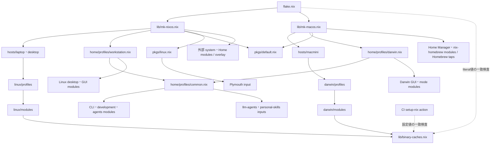

# nix-configs リファクタ計画

## 目的と前提

責務の所有者と依存先を追いやすくし、共通設定の重複と不要な組み立て引数を減らす。Linux と Darwin の組み立て関数、既存の機能 module、明示的な import を土台にする。

- Linux は laptop / desktop、Darwin は物理ホスト macmini の構成を維持する。
- OS 別の配置は `nix-configs/linux/` と `nix-configs/darwin/` に揃える。現在の `feature/` を `linux/` へ改名し、`darwin/` は維持する。
- GitHub Actions の workflow は `lint`・`publish-cache`・`update-flake-lock` の 3 つに整理する。
- macmini は単一の `darwinConfigurations.macmini` で管理し、ログイン中に desktop / server モードを即時切り替える。切り替え時に Nix の再評価・build・再適用を行わない。
- server モードでもログイン状態と GUI アプリのインストールを維持する。SSH・開発 CLI・常駐処理を利用し、指定した desktop 用常駐アプリを停止する。
- 構造変更、package の生成結果が変わり得る変更、Darwin の新しい切り替え機能を段階ごとに分ける。
- 新しいテストファイルや fixture は追加せず、既存の検証 script、Nix 評価・build、実機確認を使う。

## 責務と変更方針

| 層 | 責務 | 整理する内容 |
| --- | --- | --- |
| `flake.nix` | inputs と構成入口の定義 | キャッシュ値を共有データへ切り出す |
| `lib/mk-nixos.nix` / `mk-macos.nix` | OS の構成生成、Home Manager 接続、外部 module 登録、引数注入 | OS 別を維持し、未使用の上書き口と不要な入力を減らす |
| `hosts/` | ホストの識別、hardware、画面・起動アプリ等のホスト差分、固定運用方針 | ホスト名・ユーザー・stateVersion・hardware 設定を維持する |
| `linux/` / `darwin/` | 各 OS のシステム設定 | 現在の `feature/` を `linux/` へ改名し、責務と内部構成を維持する |
| `linux/profiles/` / `home/profiles/` / `darwin/profiles/` | 機能の選択と用途別の bundle | 実装を module に寄せ、共通 CLI と OS・desktop 固有部分を分ける |
| 各 `modules/` | 単一機能の設定・状態・公開コマンド | 他機能へ渡す値の所有者と型を明確にする |
| `pkgs/` | derivation とその列挙 | 共通 / Linux 固有の registry を分け、build・patch 処理を package 側に置く |
| `lib/` の共有値 | 純粋なデータ・変換 | module から flake 入口への逆参照を解消する |

### OS 別ディレクトリの改名

`feature/modules/` と `feature/profiles/` を、それぞれ `linux/modules/` と `linux/profiles/` へ移す。`linux/` と `darwin/` を同じ階層に置き、`home/`・`hosts/`・`lib/`・`pkgs/` の責務と配置を維持する。

改名は基準状態の記録直後に独立した段階として行い、profile の分割や設定値の変更と混ぜない。ホスト等の import、`scripts/ci/check-binary-caches.sh` の固定パス、`.github/workflows/ci.yml` の差分検知パス、`AGENTS.md` と関連文書を同じ変更で更新する。以降の配置案は改名後の `linux/` を基準に記載する。

### profile と package

Home の共通 CLI・開発・agent 設定を `home/profiles/common.nix` に集める。現行の workstation / Darwin profile が直接共有する 21 ファイルには WezTerm・Zed の GUI 設定も含まれるため、21 ファイル全体をそのまま common に移さず、GUI 設定は desktop 側へ残す。

`packages/desktop.nix` からの `core-cli.nix` import を共通 profile へ移し、lazygit 等の重複する package 指定を整理する。Linux 固有の Claude 通知設定、Darwin 固有の CLI・Karabiner・Raycast・OmniWM は対応する側に残す。共通 module 内の OS 分岐は、共有 import であることだけを理由に削除しない。

`linux/profiles/gaming.nix` 内の Steam / GameMode 設定を機能 module へ、`vr.nix` 内の WiVRn / OpenXR 設定を `linux/modules/services/wivrn.nix` へ移す。desktop の VR 有効化と laptop の選択を維持し、移動と同時に GPU 設定を汎用化しない。

`pkgs/default.nix` は共通 package、追加する `pkgs/linux.nix` は Linux 固有 package と Plymouth の外部ソース接続を担当する。Linux は両者を組み合わせ、Darwin は共通部分を使う。分類は各 derivation の対応 platform と現在の利用箇所を照合して決める。既存 consumer の `localPackages` 属性名は維持する。

WiVRn の NVENC / RUNPATH 修正は package 側へ移し、registry を列挙中心に戻す。Darwin builder へ渡している Plymouth input と、consumer がない system `specialArgs.nixosLoadingPlymouth` は整理する。

### builder と共有データ

OS 別 builder は dotfiles 専用の組み立て関数として保つ。現在呼び出し側で上書きしていない `platformModules`・`sharedHomeModules`・`systemOverlays` は内部の固定配線へ戻す。実際に使用している `extraModules` は利用箇所を処理するまで維持する。

外部 module の登録は一律に機能側へ移さない。Lanzaboote のように登録が flake、機能設定が module に分かれる箇所は、imports 解決時に利用できる明示的な引数を渡して機能側へまとめる候補とする。`inputs` 全体の注入や OS 共通 builder は導入しない。

`lib/binary-caches.nix` を純粋な attrset として追加し、flake と両 OS の Nix module が参照する。現在の Linux `substituters` と Darwin `extra-substituters` の使い分けは維持する。`scripts/ci/check-binary-caches.sh` の配置名に依存する検査も、共有値と実際の設定の一致を検査する形へ更新する。

Linux の `localPackages` を、現在の `nixpkgs.legacyPackages` から構成中の `pkgs` へ揃える変更は別段階とする。overlay/config の適用により derivation が変わり得るため、registry 分割の機械的な移動に混ぜない。

### Linux desktop の機能間契約

| 対象 | 変更 | 維持する責務 |
| --- | --- | --- |
| 壁紙 / Niri | 壁紙 module の `niriSpawnCommand` にある KDL 生成を Niri 側へ移す | 壁紙は fallback image/mode と restore command を公開し、Niri が起動設定を生成する |
| 省電力状態 | `ecoMode.enabledFile` を read-only で公開し、shell・Wallpaper・Waybar の参照を統一する | 状態、停止対象、復元処理は eco-mode が所有する |
| Quick Shell | 公開コマンドを package 型へ揃え、Niri 側で実行パスへ変換する | appId とコマンドの提供、window rule と keybind の生成を分ける |
| 画面情報 | 現在の Niri monitor 定義を単一の情報源として維持する | Wallpaper と Lockscreen が同じ画面情報を使う |
| Vicinae | 壁紙の preset 一覧と公開コマンドを使う境界を維持する | launcher 側で preset 操作を生成する |

共有 display model、汎用 hook/event bus、desktop 全体を統合する新しい controller は追加しない。Wallpaper・Waybar・Lockscreen は現在の機能単位を保つ。

## GitHub Actions の整理

`.github/workflows/` は次の 3 ファイルとし、共通の `.github/actions/setup-nix/action.yml` は composite action として維持する。

| workflow | 起動条件 | 責務 |
| --- | --- | --- |
| `lint.yml` | PR、master への push、手動実行 | Nix 構文、Nix / Lua 整形、キャッシュ設定、profile 契約を検証する。現在の `nixos.yml` の laptop / desktop build は PR・手動実行の job として移管する。Lua のチェックは段階 10 で削除する |
| `publish-cache.yml` | master への push、手動実行 | laptop / desktop の build・署名・cache publish を行う。push の変更内容による除外を設けない |
| `update-flake-lock.yml` | 毎朝 08:15 日本時間、手動実行 | 全 flake inputs を更新し、差分があれば既存の更新 PR を作成・更新する |

### Nix installer と workflow の移管

`setup-nix/action.yml` の installer を `nixbuild/nix-quick-install-action` に変更する。実装時に[公式 release](https://github.com/nixbuild/nix-quick-install-action/releases)を確認し、既存方針に合わせて安定版の SHA を固定する。`extra_nix_config` は新 installer の `nix_conf` へ移し、信頼する cache、公開鍵、flake 設定の受け入れ方針を維持する。[公式 README](https://github.com/nixbuild/nix-quick-install-action#readme)

新 installer は single-user 構成なので、cache publish tooling を含む既存コマンドが daemon・system の nix.conf・NIX_PATH を前提にしていないか確認する。installer の変更だけを理由に検証対象や cache service を変更しない。

`ci.yml` の中継と `nixos.yml` は、検証 job と起動条件を移管してから削除する。master push の build は `publish-cache` が担当し、PR・手動の検証 build は `lint` が担当する。既存の required checks に旧 job 名が登録されている場合は、移管先と対応づけて更新する。

installer の置き換え、workflow の移管、起動条件の変更は、それぞれ差分を分けて確認する。`AGENTS.md` の CI 説明と `docs/flake-updates.md` の運用説明も実装に合わせて更新する。

### 日次更新と publish の起動条件

日次更新は cron `15 23 * * *` とし、日本時間の毎朝 08:15 に設定する。GitHub の UTC 基準では前日の 23:15 に相当する。schedule は default branch に配置し、混雑による実行遅延があり得るため、時刻は起動予定時刻として扱う。[GitHub の schedule 仕様](https://docs.github.com/en/actions/reference/workflows-and-actions/events-that-trigger-workflows#schedule)

更新 PR は現在の GitHub App token による作成・更新と手動 merge の運用を維持する。`flake.lock` のみの PR も `lint` と検証 build の対象にし、master へ入った lock 更新も通常の push と同じく publish の起動対象にする。

現在の `ci.yml` にある lock-only PR の `paths-ignore`、publish を制限する差分フィルタ、`publish-cache.yml` の成功後 1 時間 cooldown を撤去する。不要になった `changes` / `cooldown` job と `scripts/ci/check-publish-cooldown.sh` も削除する。現状の publish 用差分フィルタ自体には `flake.lock` が含まれているため、実装時は lock 専用の publish 除外があると決めつけず、呼び出し経路と抑止条件全体を整理する。

publish の production environment・認証情報の境界と同時実行防止は維持し、PR では publish しない。concurrency は並行 publish を防ぐための設定であり、GitHub の pending run 置換により、すべての push が個別に publish を完了する保証にはならない。[GitHub の concurrency 仕様](https://docs.github.com/en/actions/how-tos/write-workflows/choose-when-workflows-run/control-workflow-concurrency)

## Darwin の実行時切り替え

Nix は両モードを利用できる固定環境を構築し、Home Manager 側の `home/modules/desktop/macos-mode.nix` が実行時モードを管理する。runtime の状態によって Nix の imports や Homebrew casks を切り替えない。

| 対象 | desktop | server |
| --- | --- | --- |
| macOS のログイン状態 | 維持 | 維持 |
| SSH・開発 CLI・AI CLI・既存の常駐処理 | 維持 | 維持 |
| GUI アプリのインストール・設定、macOS preferences | 維持 | 維持 |
| 管理対象の OmniWM / Raycast | 起動 | 停止 |
| 管理対象以外のブラウザ・エディタ等 | 操作しない | 操作しない |
| 現行のスリープ防止 | 共通設定として維持 | 共通設定として維持 |

### 操作と状態

以下は追加予定のコマンドであり、現時点では存在しない。

```sh
mac-mode desktop
mac-mode server
mac-mode status
```

- 希望モードは Home Manager の `xdg.stateHome` 配下に保存する。checkout や Nix store に実行時状態を置かない。
- 未設定時は現在の自動起動に合わせて desktop を既定とする。状態は原子的に保存し、同一ユーザーの同時操作を直列化する。
- 同じ切り替えを再実行しても安全に状態を合わせる。途中失敗では非ゼロで終了し、失敗した管理対象を表示する。希望モードは残し、再実行で調整できるようにする。
- `status` は希望モードと観測した実稼働を分けて表示する。状態ファイルを書けただけで切り替え成功としない。
- アプリ module が起動ジョブと必要な終了方法を定義し、mode 管理は明示した対象だけを制御する。GUI process の一括探索・強制終了は行わない。
- ログイン時と Home Manager 再適用時にも保存済みモードを尊重する。OmniWM / Raycast の無条件 `RunAtLoad` を見直し、server 中に一度起動してから停止する構造を避ける。

Raycast は現在 `/usr/bin/open -W -a` 経由で起動するため、起動ジョブの停止とアプリ本体の終了を別々に確認する。現行の [Home Manager launchd 実装](https://github.com/nix-community/home-manager/blob/32904dfe1cf86039f3c8c9f41f94e1cfd76dbb34/modules/launchd/default.nix) と macmini 実機で、ユーザーの GUI session に対する制御とアプリの正常終了を検証する。

この計画の初期範囲は管理対象の常駐制御とする。既存 shell の `EDITOR` 等を外部から書き換えず、editor のモード連動が必要なら呼び出し時に状態を読む wrapper を別途検討する。ログアウト後の server 稼働や、desktop 中だけスリープを許可する機能は含めない。

## 実施順序と完了条件

各段階の確認を終えてから次へ進む。段階内でも構造変更と動作変更を分け、途中で問題が出た場合に直前の差分へ戻せる単位にする。

| 順序 | 作業 | 完了条件・対象限定の検証 |
| --- | --- | --- |
| 0 | 基準状態を記録する | laptop / desktop / macmini の hostname、ユーザー、editor、package 選択、生成設定、symlink 先、関連 service/agent を記録する。Nix 評価の結果と実機の観測を区別する |
| 1 | `feature/` を `linux/` へ改名し、参照元・CI・配置ルールを更新する | 旧パスの残存を検索し、移行説明以外の稼働参照を解消する。CI の差分検知が新パスを対象にすることを確認する。`just syntax`、`just profile-check`、`just binary-cache-check` と対象属性の比較で設定値を維持したことを確認する |
| 2 | Home 共通 CLI profile、package 選択、gaming / VR module を整理する | import 集合と設定値を維持する。Linux は既存 `just profile-check`、Darwin は identity / CLI / GUI 設定の対象属性を評価し、基準と比較する |
| 3 | キャッシュデータを抽出し、既存検証 script を更新する | flake・Linux・Darwin・CI setup action のキャッシュ値が一致する。`just binary-cache-check` と両 OS の対象設定評価で確認する |
| 4 | `.github/` を 3 workflow に整理し、Nix installer・起動条件・日次更新時刻を変更する | YAML / actionlint と旧参照の検索で構成を確認する。GitHub 上で通常 PR・lock-only PR・master の lock 更新 push・手動実行を確認し、検証 job の維持、publish の抑止条件撤去、App token による更新 PR の CI 起動を確認する |
| 5 | package registry を OS 分離し、builder の入力と配線を整理する | Darwin の Plymouth input 依存を解消し、各 host の package 選択と外部 module の登録を維持する。対象 package の評価・必要な build、既存 profile 検証を行う |
| 6 | Linux desktop の公開契約を整理する | KDL、Waybar 設定、eco 状態パス、公開コマンドを比較する。対象生成物を build し、実機で起動・省電力・ロック復帰を確認する |
| 7 | Darwin の mode 管理を実装し、Darwin Home profile へ import して OmniWM / Raycast に接続する | `macos-mode.nix` が `home/profiles/darwin.nix` 経由で有効になる。初回 desktop、desktop → server → desktop、同一モードの再実行、失敗表示、再ログイン、HM 再適用を実機で確認する。SSH・CLI・管理対象外アプリを維持する |
| 8 | Linux の package set 統一を別変更として判断・実施する | 現行との差分を比較し、overlay/config による derivation・依存・生成設定の変更を説明できる。意図しない差分があれば原因を解消してから採用する |
| 9 | 実装後の構成と依存図を照合する | import、外部 input、package、runtime mode 管理の責務を図へ反映する。最後に全構成の検証結果と未確認事項を記録する |
| 10 | Lua の linter / 整形チェックと `justfile` を削除する | CI の `lua-formatting` / StyLua チェックを削除し、リポジトリの検証が Lua チェックや `just` に依存しないことを確認する。不要になった専用依存を整理し、README・運用文書・Raycast setup 等の案内を直接コマンドへ更新するか、不要な案内を削除する。旧コマンドの稼働参照を検索して解消する。Nix 構文・整形・lint、profile / cache 検証と両 OS の build を維持する。`AGENTS.md` の最終整備は下記 TODO とし、完了条件には含めない |

段階 8 は単なる移動ではなく package の出所を変更する段階であり、差分の検討結果によっては別の後続作業に分ける。段階 7 の新機能には、既存設定の整理とは独立した差分と実機確認を用意する。

段階 10 は検証 tooling の整理として独立させる。前段の `just ...` は当該段階で使う現行コマンドであり、`justfile` 削除後は下記の直接コマンドを使う。StyLua 等がエディタの formatter としても利用されている場合は、CI 専用の依存と区別し、Lua チェックの削除だけを理由に編集機能まで削除しない。

参照更新には `README.md` の適用・検証手順と `home/modules/apps/raycast.nix` の `raycast-setup` 案内も含める。リポジトリ内の `just` コマンド参照を検索し、過去の移行説明と最終整備 TODO の対象である `AGENTS.md` を除き、実行不能な案内を残さない。

## 検証と適用

### 作業中の確認

変更に関係する構文・整形・属性評価・既存検証 script を対象限定で実行する。新しい Nix ファイルは import 元に接続し、flake で評価する前に Git に track する。コミット指示前の作業中に、CI 相当の包括チェックを繰り返さない。

基準との比較では、package の選択と出所、生成設定の内容、symlink の解決先、service/agent の設定を確認する。移動に伴う store path の変化と、実際の設定値・依存の変化を区別する。

既存の `scripts/ci/check-profiles.sh` は Linux 中心であり、Darwin の契約を代替しない。Darwin の identity・CLI・agent 定義は対象属性を個別に評価し、必要な検査は既存 script に整理する。対象 module を評価しただけで runtime の切り替えが動作したとは扱わない。

`.github/` の変更では YAML と actionlint に加え、composite action の inputs を選んだ installer revision と照合する。実際の GitHub runner で Nix 導入、既存検証、build、署名・publish の成功を確認し、日次更新の schedule と手動起動の両方を確認する。ローカル検証だけで GitHub のイベント起動・認証・schedule が確認済みとは扱わない。

書き戻し可能な Zed・lazygit・fcitx5・Karabiner・OmniWM 設定は、現在の out-of-store symlink 方針を維持する。関連ファイルを移動する場合は文字列パスも一緒に更新する。Codex の既存設定を保持する seed 動作も既存検証で確認する。

### 実機で確認する挙動

| 環境 | 確認内容 |
| --- | --- |
| Linux laptop / desktop | 画面配置、キー操作、静的背景 → 壁紙復元の起動順序、時刻別 preset、省電力中の復元抑止、元々稼働していた対象だけの復元、ロック解除時の画面・壁紙復帰 |
| macmini | mode 操作中に Nix 再適用を呼ばないこと、OmniWM / Raycast の実体の停止と再起動、二重起動防止、状態保存と実稼働表示、失敗後の再実行、server の再ログイン・HM 再適用時の維持 |
| macmini の共通環境 | SSH 接続、開発 CLI、既存常駐処理、管理対象外 GUI、GUI アプリのインストール、preferences、スリープ防止が切り替えで変更されないこと |

ログアウト・再ログインの確認は作業を退避できるタイミングで行い、接続断を伴う確認として扱う。build による検証と、構成を適用した実機での確認を分けて記録する。

### コミット前の包括確認

ユーザーからコミットの指示を受け、予定した変更が揃った時点でまとめて実行する。段階 10 後も実行できるよう、`justfile` に依存しないコマンドを記載する。

共通の構文・Nix 整形・lint:

```sh
git ls-files -z '*.nix' | xargs -0 -n1 nix-instantiate --parse --quiet
alejandra --check .
statix check .
deadnix --fail .
```

Linux:

```sh
bash scripts/ci/check-wsl.sh
bash scripts/ci/check-profiles.sh
bash scripts/ci/check-binary-caches.sh
nix build --no-link .#nixosConfigurations.laptop.config.system.build.toplevel
nix build --no-link .#nixosConfigurations.desktop.config.system.build.toplevel
```

laptop と desktop の両方を明示的に build する。lint の既存警告で失敗した場合は今回の差分との関係を切り分け、失敗を残したままコミットしない。無関係な大規模修正へは広げない。

macmini 上:

```sh
nix --extra-experimental-features 'nix-command flakes' build .#darwinConfigurations.macmini.system --no-link
```

適用する段階では、Linux は `nh os switch . -H <host>`、macmini は次の直接コマンドと前述の実機確認を使う。

```sh
nix --extra-experimental-features 'nix-command flakes' build .#darwinConfigurations.macmini.system
sudo ./result/sw/bin/darwin-rebuild switch --flake .#macmini --option accept-flake-config true
```

初回の実装導入には Nix の適用が必要だが、導入後の `mac-mode` 切り替えには不要とする。Linux の評価・build、macOS の build、実機の動作確認を別々の証拠として記録する。

この文書作成時点では、ここに記載した評価・build・実機検証・適用は実施していない。

## TODO（完了条件の対象外）

- [ ] 順序 0〜10 の全リファクタ結果を踏まえ、[AGENTS.md](../AGENTS.md) を最終整備する。実際のディレクトリ構成、責務、3 workflow の運用、Darwin の実行時切り替え、Lua チェックと `justfile` の削除後の直接コマンド・検証方法を反映する。

この TODO の実施は各段階および計画全体の完了条件に含めず、未完了でもリファクタの完了を判定できる。各段階で必要な配置・CI 参照の更新と、全結果を統合した最終整備を分けて扱う。

## 実施記録

段階 0 の基準は `f96a07d12c6947c02e6ce8d92a6ee1866991f971` の独立コピーから記録した。Linux 上の Nix 評価で、3 ホストの identity・editor・package 選択・生成設定・symlink 定義・service/agent 定義、および Linux の WiVRn/OpenXR 設定を取得した。実機の状態を観測した記録ではない。

### 実装後の構成



builder から Home profile への接続は各 host の `home.nix` を経由する。Linux の `localPackages` は構成中の `pkgs` から生成し、system module には `_module.args`、Home Manager には `extraSpecialArgs` で渡す。Lanzaboote は明示的な module 引数を受け取り、Linux の機能 module が import する。

Darwin は app module が対象 app bundle と launchd agent を定義し、`macos-mode.nix` がその2対象を `mac-mode` へ渡す。`mac-mode` は `xdg.stateHome/mac-mode/mode` の希望値と GUI session の job・アプリ実体を扱う。ログイン agent と Home Manager の `setupLaunchAgents` 後の activation は同じ reconcile を呼ぶ。

### 段階ごとの結果

| 段階 | 実施内容・判断 |
| --- | --- |
| 1 | `feature/` → `linux/` と参照更新。設定の移動のみを独立コミットにした |
| 2 | 共通 CLI profile と gaming / VR module を抽出。GUI・OS 固有設定、desktop の VR 選択を維持し、lazygit の重複を除去した |
| 3 | OS のキャッシュ設定を共有データへ変更。Nix 2.34.9 が `nixConfig` の import / thunk を拒否するため、flake のリテラルは保持し、共有データ・両 OS・CI との一致を既存 script で検査する |
| 4 | 3 workflow、v35 の SHA 固定 installer、日次 08:15 JST、lock-only PR の検証、master 全 push の publish に整理した |
| 5 | 共通 / Linux registry を分離し、WiVRn RUNPATH 処理を package へ移動。Darwin の Plymouth 引数と未使用の builder 上書き口を除去し、Lanzaboote の登録を機能側へまとめた |
| 6 | 壁紙の KDL 生成を Niri へ移し、省電力状態ファイルを read-only 公開。Quick Shell のコマンドを package 型へ統一した |
| 7 | `mac-mode desktop/server/status`、原子的保存・直列化・実稼働表示・正常終了・再試行を実装。対象 job の無条件起動を止め、ログイン / HM 再適用時の reconcile に接続した |
| 8 | Linux の `localPackages` を構成中の `pkgs` へ統一。採用前の候補比較では、laptop / desktop と legacy の全16 derivation が一致した |
| 9 | 実装と依存図を照合し、検証範囲と未確認事項を記録した |
| 10 | 未実施。段階9のコミット後に Lua チェックと `justfile` の削除を行う |

### 検証範囲

ユーザーの「build や lint などの check は不要」という後続指示以降、追加のチェックは実行していない。段階ごとにコミットし、push と構成の適用は行っていない。

指示変更前には、段階に応じて構文・整形・既存 profile / binary-cache script、YAML / actionlint、対象限定の lint を実行した。registry 分割前後の全16 derivation、Linux の gaming / VR と package 選択、Darwin の identity・editor・package 選択・GUI / agent 定義を比較した。共通 profile 化による Darwin のフォント marker の store path 変化は、package 順序の変更によるものだった。

Linux desktop の Niri KDL・Waybar 設定と省電力状態パスは、store hash を除いて基準と一致した。laptop の生成設定・symlink・service 定義も同様に一致し、Quick Shell・省電力・壁紙復元の対象コマンドの build と Niri の設定検証を実施した。Linux 全構成の build は完了条件として確認していない。

Darwin mode は対象属性の評価と一時シミュレーションで、初期 desktop、往復・同一モード、部分失敗・希望値保持・再試行、終了拒否時の起動抑止、job とアプリの稼働ずれ、同時操作の直列化を確認した。Darwin の build・実機検証・適用はユーザー指示により行っていない。実際の launchctl / AppKit 制御、再ログイン、HM 再適用の動作は未確認である。

GitHub runner 上の Nix 導入・イベント起動・認証・署名 / publish・schedule と、段階8を組み込んだ最終構成の再評価は未確認である。
